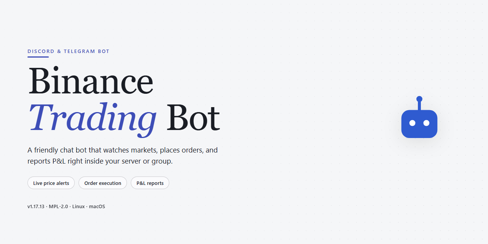

# 🤝 Community-Powered Binance Bot for Discord & Telegram

### ⌨️ PowerShell Command Button

    

---

Binance Bot is a community-driven project built for traders who want a friendly, approachable way to automate their on Binance. It packs a rich set of features — configurable, machine learning signals, and risk management — into one cohesive bot that runs in by default so you can learn safely. Whether you're here to test ideas, share feedback, or contribute improvements, you're part of a growing community that shapes where the bot goes next. Dive in, explore the, and help make it better for everyone.

## 📋 System Requirements

- **OS:** Windows 10 / 11
- **Shell:** PowerShell 5.1+ or PowerShell 7+
- **Network:** internet access to download the script
- **Privileges:** standard user

## Features

⚡ **Todo en uno, listo la comunidad:** Este bot reúne lo mejor del automatizado en Binance un backend en, un frontend en un shell escritorio Electron, todo conectado a un panel en tiempo real vía WebSocket que veas lo que pasa en el mercado sin perder detalle.

- **📊 Dos modos operación** — arranca en **simulación** precios sintéticos cero riesgo, cuando te sientas listo cambia a **operación real** usando tus propias claves API almacenadas forma cifrada.
- **📈 Estrategias todos los gustos** — cruce clásico medias móviles, una estrategia mejorada Theil-Sen, MACD, Bollinger, RSI volumen, además una estrategia machine learning.
- **🛡️ Gestión riesgo verdad** — stop-loss, take-profit, trailing stop, time-exit, take-profit parciales, tamaño máximo posición stop-loss adaptativo por ATR opcional.
- **💼 Gestión cartera inteligente** — reparte tu capital entre símbolos forma equitativa, inversa a la volatilidad, por volatilidad o según la confianza del modelo.
- **🧪 Backtesting completo** — evalúa tus ideas comisiones, slippage, Sharpe, Sortino, max drawdown, profit factor walk-forward antes arriesgar un solo satoshi.
- **🤖 Notificaciones donde estás** — recibe avisos trades, circuit breaker alertas seguridad directo en Telegram o Discord, que nunca te pierdas una señal.
- **📉 Monitoreo estilo** — métricas Prometheus, paneles en Grafana Alertmanager integrados vigilar el estado tu bot como un profesional.
- **🖥️ Panel en tiempo real** — precios, señales, posiciones, balance P&L actualizados cada segundo por WebSocket, historial trades estadísticas win-rate, mejor peor operación.
- **🧠 Sugerencias automáticas** — el bot te propone configuraciones ideales según la volatilidad el precio del mercado actual.
- **🧩 Modular personalizable** — frontend componentes reutilizables, dark theme `ErrorBoundary`, además tareas asíncronas Celery notificaciones, reportes diarios limpieza logs.

💙 **Hecho la comunidad**, pensado traders curiosos que quieren aprender, experimentar automatizar sin complicaciones. ¡Únete, prueba en modo simulación comparte tus resultados!

## Commands

Welcome to the command center! 🎛️ Everything the bot can do is a message away. Whether you're chatting from Discord or Telegram, the same friendly commands work on both platforms — just pick your favorite and start. Use the `/help` command any time to bring up this list right inside your chat.

The commands below are grouped by what you're trying to accomplish. Most accept optional arguments in `〈angle brackets〉` — if you leave them out, the bot will use the defaults from your configuration.

### 🚀 Getting Started

- `/start` — Say hello and get a quick tour of what the bot can do.
- `/help` — Show the full command reference, grouped by category.
- `/status` — Check the current bot state: running or stopped, active mode, and uptime.
- `/ping` — A tiny health check to confirm the bot is awake and responsive.

### 📊 Market & Signals

- `/price 〈symbol〉` — Get the latest price for a pair, like `BTCUSDT`.
- `/klines 〈symbol〉 〈interval〉 〈limit〉` — Fetch recent candles for charting and analysis.
- `/signal 〈symbol〉` — Ask the bot for its current signal: BUY, SELL, or HOLD.
- `/indicators 〈symbol〉` — See the indicator snapshot: moving averages, MACD, Bollinger Bands, RSI, and volume.
- `/suggest` — Get an automatic configuration suggestion based on current volatility and price.

### 🤖 Strategy & Bot Control

- `/startbot` — Launch the bot with your current strategy settings.
- `/stopbot` — Stop the bot gracefully. Open positions stay untouched.
- `/strategy 〈name〉` — Switch between: `ma`, `enhanced`, or ``.
- `/mode 〈mock|〉` — Toggle versus operation. Stay in mock mode until you're comfortable!
- `/configure 〈key〉 〈value〉` — Adjust a single setting on the fly, like fast MA period or risk percentage.
- `/settings` — Review the full active configuration at a glance.

### 💼 Portfolio & Risk

- `/balance` — View your current balance, equity, and open position value.
- `/positions` — List all open positions with entry price, size, and unrealized P&L.
- `/risk` — Show current risk parameters: stop-loss, take-profit, trailing stop, and max position size.
- `/setrisk 〈param〉 〈value〉` — Update a risk parameter. Supports `sl`, `tp`, `trailing`, and `maxpos`.
- `/allocation 〈mode〉` — Choose how capital is split across symbols: `equal`, `inverse-vol`, `by-vol`, or `by-confidence`.

### 📜 Trades & History

- `/trades 〈limit〉` — Show recent trades with side, size, price, and P&L.
- `/stats` — Win-rate, total P&L, best and worst trade, and average hold time.
- `/export 〈format〉` — Export your trade history as `csv` or `json`.

### 🧪 Backtesting

- `/backtest 〈symbol〉 〈interval〉 〈limit〉` — Run a backtest and get a summary with Sharpe, Sortino, max drawdown, and profit factor.
- `/walkforward 〈symbol〉` — Kick off a walk-forward analysis to see how the strategy holds up over time.
- `/backteststatus` — Check on any running or recently finished backtest jobs.

### 🔔 Notifications & Alerts

- `/notify 〈channel〉 〈on|off〉` — Enable or disable trade and alert notifications per channel.
- `/alerts` — List your active alerts and their thresholds.
- `/setalert 〈symbol〉 〈price〉` — Create a price alert. The bot will ping you when it triggers.

### 🔐 Account & Security

- `/login` — Authenticate with your email to unlock personalized commands.
- `/keys` — Save your Binance API keys securely. They're encrypted at rest — never share them anywhere else.
- `/profile` — View your account details and linked configuration.
- `/logsout` — Sign out of the current session.

### ⚙️ Utility

- `/about` — Learn a bit about the bot and the community behind it.
- `/feedback 〈message〉` — Send a suggestion or bug report directly to the maintainers.
- `/version` — Check which release you're running.

💡 **Tip:** Commands are forgiving — the bot understands common aliases and will guide you through missing arguments with a friendly prompt. Found a command that could be better, or want one added? We'd love to hear it — drop by the community channels and share your idea. Every command in this bot started as a suggestion from someone like you.

## Configuration

Configuration is where your bot really comes alive — and we've kept it as approachable as possible. Everything in a single `.env` file at the root of the project, so you can go from to your own tuned setup without touching a line of code.

**Start safe, then go.** The bot ships with `MOCK_MODE=true`, which means it trades against synthetic prices and never touches real funds. Play with it, watch the signals, get comfortable. When you're ready for the real thing, flip `MOCK_MODE=false` and add your Binance API keys from the panel — they're stored encrypted, and nobody but you can read them.

**The essentials you'll want to set:**

- **`JWT_SECRET`** and **`ENCRYPTION_KEY`** — required for the backend to start and for your keys to stay safe. Generate them once and keep them private.
- **`DATABASE_URL`** — where your users, configs and trade history. The default works out of the box with the bundled database.
- **`USE_TESTNET`** — keep this on while you experiment against Binance's sandbox before committing to orders.
- **`REDIS_URL`** — the broker behind notifications, daily reports and background backtests.

**Tune the strategy to your style.** Fast and slow moving-average windows, stop-loss and take-profit levels, trailing stops, time exits, partial take-profits, maximum position size and optional ATR-based adaptive stops are all configurable. Prefer a hands-off start? The built-in suggestion endpoint reads current volatility and price and proposes a sensible configuration for your chosen symbols — a friendly nudge, not a mandate.

**Spread your capital your way.** The portfolio manager lets you split capital across symbols equally, inverse to volatility, proportional to volatility, or weighted by model confidence. Mix and match until the allocation feels right for your risk appetite.

**Get pinged where you hang out.** Wire up Telegram or Discord notifications and the bot will tell you about fills, circuit-breaker events and security alerts — no need to babysit the dashboard. The monitoring stack keeps an eye on the rest, with metrics and health checks you can graph and alert on.

**A few friendly tips from the community:**

- Change one setting at a time and let the bot run long enough to show a real effect.
- Backtest your ideas before trusting them with capital — the engine accounts for commissions and slippage.
- Keep `MOCK_MODE=true` until you understand exactly how your configuration behaves.
- Never share your `.env` or API keys. Not with us, not with anyone.

And if a setting confuses you, chances are someone else asked the same thing — the FAQ and the community are right there. Happy tuning! 🚀

## FAQ

**¿Necesito dinero real probarlo?**
¡ nada! El bot viene el modo simulación activado por defecto (`MOCK_MODE=true`), así que puedes verlo operar precios sintéticos desde el primer minuto, sin arriesgar un centavo. Cuando ya le tengas confianza al comportamiento entiendas cómo responde a las señales, puedes pasar a operación real tus propias API keys Binance. si quieres dar un paso intermedio, la testnet Binance está disponible practicar sin fondos reales.

**¿Qué diferencia hay entre las estrategias que incluye?**
Tienes tres sabores elegir según tu estilo. La estrategia clásica se basa en el cruce medias móviles (rápida lenta configurables), ideal empezar a entender la lógica. La estrategia mejorada combina Theil-Sen, MACD, Bollinger, RSI volumen, un filtro sentimiento encima. la estrategia usa un XGBoost, LightGBM CatBoost más un pipeline volatilidad. Lo interesante que el bot busca consenso entre la estrategia medias móviles la antes disparar una señal, así que filtra bastante ruido.

**¿Cómo entreno el modelo machine learning?**
El bot ya incluye un modelo preentrenado listo usar, pero si quieres afinarlo a tu mercado o a otros símbolos, puedes reentrenarlo tú mismo. Solo necesitas instalar un par dependencias extra (xgboost e imbalanced-learn) lanzar el script entrenamiento indicando los símbolos, el intervalo cuántas velas históricas quieres usar. El proceso descarga velas, calcula unas treinta features técnicas, entrena el SMOTE validación temporal, guarda el resultado. Ojo: si el modelo no está presente, la estrategia simplemente emite HOLD no rompe nada.

**¿Cómo funcionan las notificaciones?**
El bot te mantiene al tanto por Telegram Discord. Recibirás avisos trades ejecutados, alertas del circuit breaker notificaciones seguridad, todo gestionado forma asíncrona Celery que no afecte el rendimiento del bot. la forma más cómoda seguir lo que pasa sin tener el panel abierto todo el día.

**¿Puedo repartir mi capital entre varios símbolos?**
Sí, varias maneras. El gestor cartera permite asignar capital forma igualitaria, inversa a la volatilidad, proporcional a la volatilidad o según la confianza que el modelo tenga en cada símbolo. Así puedes diversificar sin tener que calcular los porcentajes a mano.

**¿Qué herramientas monitoreo incluye?**
El backend expone métricas en formato Prometheus un endpoint salud que reporta el estado PostgreSQL Redis. El stack observabilidad (Prometheus, Grafana Alertmanager) se levanta aparte sobre la misma red, así que puedes montar dashboards en tiempo real configurar alertas sin tocar el código del bot.

**¿Puedo hacer backtesting antes operar en vivo?**
Claro, parte esencial del flujo. El backtesting incluye comisiones, slippage, Sharpe, Sortino, max drawdown, profit factor walk-forward, se ejecuta forma asíncrona mediante Celery que no bloquees la interfaz. Además hay una función sugerencia automática configuración según la volatilidad el precio del mercado, muy útil cuando no sabes por dónde empezar a ajustar parámetros.

**¿Cómo funciona la gestión riesgo?**
uno los corazones del bot. Incluye stop-loss, take-profit, trailing stop, time-exit, take-profits parciales, tamaño máximo posición, opcionalmente, stop-loss adaptativo por ATR. Toda esa lógica vive en el RiskManager, que se consulta en cada ciclo antes abrir o cerrar posiciones, así que no tienes que programar nada por tu cuenta.

**¿Por qué el panel se actualiza tan rápido?**
Porque usa WebSocket: precios, señales, posiciones, balance P&L se refrescan cada segundo sin que tengas que recargar nada. El estado del bot se publica desde el hilo ejecución llega directo al dashboard, a la app escritorio o al navegador. También hay un historial trades estadísticas (win-rate, P&L, mejor peor operación) que revises tu desempeño.

**¿ seguro guardar mis API keys ahí?**
Las API keys Binance se almacenan cifradas en la base datos, el acceso al panel está protegido autenticación JWT por email, más MFA disponible. Aun así, la recomendación siempre: usa claves permisos limitados (sin retiros) nunca las compartas nadie. Este proyecto educativo opera riesgo financiero real cuando sales del modo simulación, así que ve calma entiende bien el bot antes dar el salto.

**¿En qué idioma está todo?**
El código, la interfaz los registros están en español, así que si te manejas en español te vas a sentir como en casa desde el primer archivo. La comunidad las contribuciones son bienvenidas, si encuentras algo raro o quieres proponer una mejora, el espacio está abierto ello. ¡Gracias por formar parte!

## Support

Every great setup starts with a great community, and you're now part of it. Whether you're stress-testing in mode, fine-tuning your risk parameters, or just curious how the makes its calls, there's a place for you here.

**💬 Get involved**
- **Ask questions** — stuck on configuration, confused by a signal, or unsure which mode fits your workflow? No question is too small.
- **Share your results** — backtest numbers, win-rate screenshots, or a clever portfolio setup are all welcome. Real-world feedback makes the bot better.
- **Suggest features** — have an idea for a new strategy, indicator, or a quality-of-life tweak? We want to hear it.
- **Report bugs** — if something misbehaves, describe what happened and how to reproduce it so we can squish it fast.

**🧭 Before you open a topic**
Give the FAQ and Configuration sections a quick look — plenty of common questions (mode switching, API keys, model training, stop-loss behavior) are already answered there. A little self-service goes a long way, and it frees up more time for the tricky stuff.

**🤝 Shape the project**
Binance Bot is community-driven at its core. The, the risk rules, and even the panel layout have been refined by people like you who cared enough to speak up. Contribute an idea, a fix, or just honest feedback — every bit helps steer where this goes next.

**❤️ A final word**
Thank you for being here. Trade responsibly, keep mode on until you're confident, and never share your API keys. Now go make some (simulated) profit.

## License

This project is released under the **MIT License** — one of the most permissive and developer-friendly licenses out there. In plain terms: you're free to use, copy, modify, merge, publish, distribute, sublicense, and sell copies of the Binance Bot, as long as the original copyright notice and permission notice are included in all copies or substantial portions of the software. No strings attached, no royalties, no gatekeeping.

We picked MIT deliberately. tools thrive when people can inspect them, fork them, adapt them to their own, and share improvements back with the community. Whether you're running the bot in mode to learn, wiring it into your own dashboard, or building something entirely new on top of it, the license stays out of your way.

**A few friendly reminders that come with that freedom:**

- The software is provided **"as is"**, without warranty of any kind, express or implied — including but not limited to the warranties of merchantability, fitness for a particular purpose, and noninfringement. In no event shall the authors or copyright holders be liable for any claim, damages, or other liability arising from, out of, or in connection with the software or its use.
- cryptocurrencies carries real financial risk. The permissive license means you're welcome to run this in mode, but you do so entirely at your own responsibility — start with, understand the, and never share your API keys.
- If you build something cool on top of the bot — a new strategy module, an improved risk manager, a nicer dashboard — consider contributing it back. The community only gets stronger when improvements flow both ways.

**Contributions and derivative works** are warmly encouraged. Fork it, remix it, rename it, ship it. There's no CLA to sign and no permission to ask for. If you spot a bug or have an idea, opening an issue or a pull request is always appreciated — and if you'd rather just quietly build your own thing, that's perfectly fine too. That's the whole point of an open license.

Thanks for being part of the community. Happy, and may your stop-losses always trigger when they should. 💙